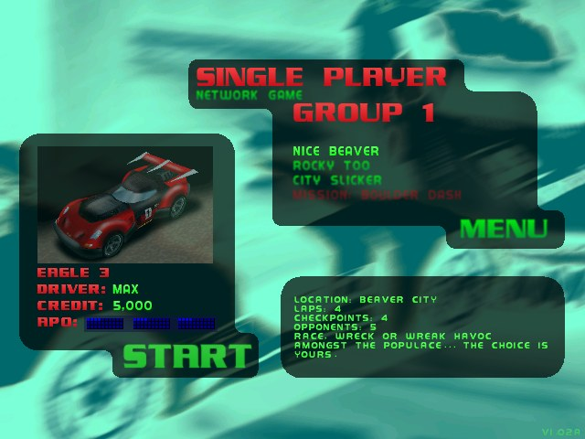
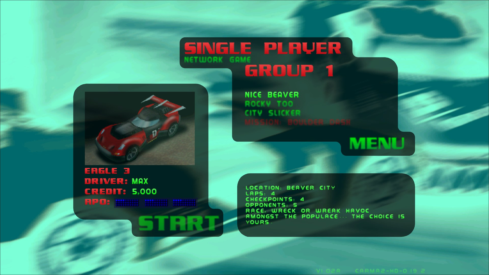
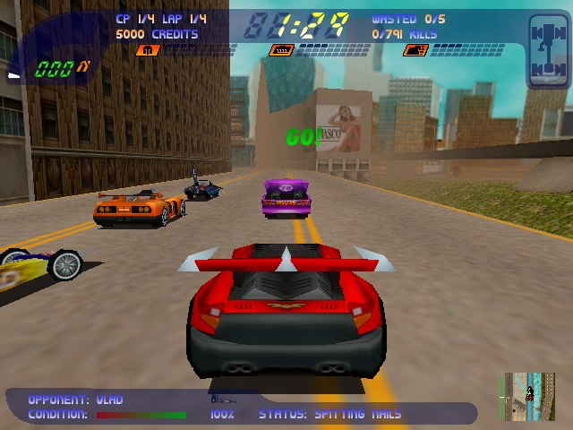
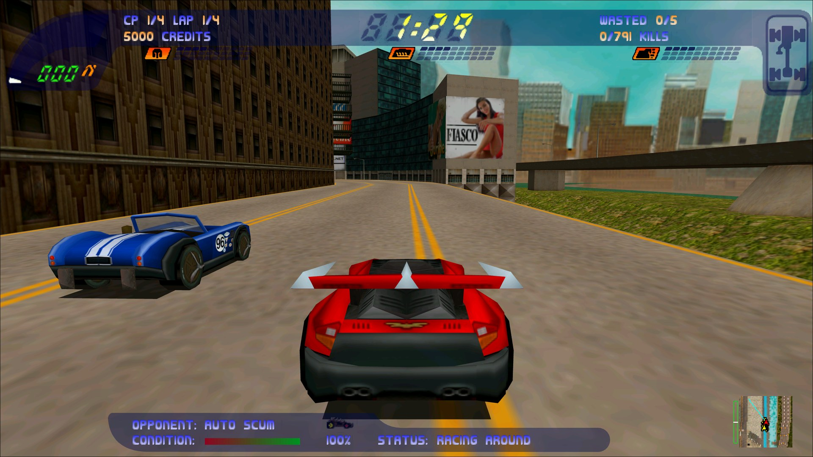
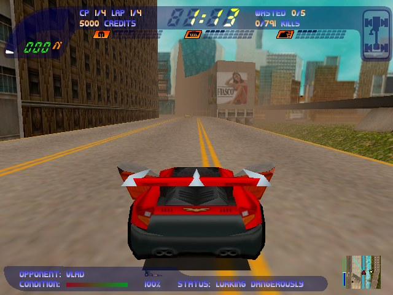
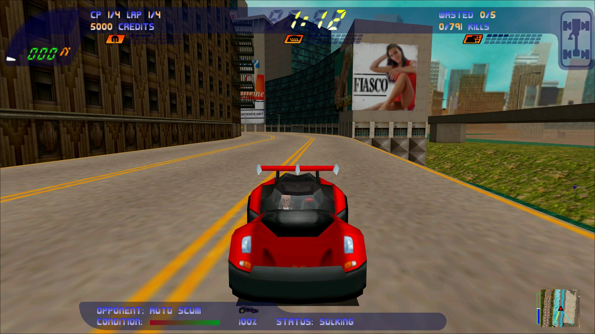
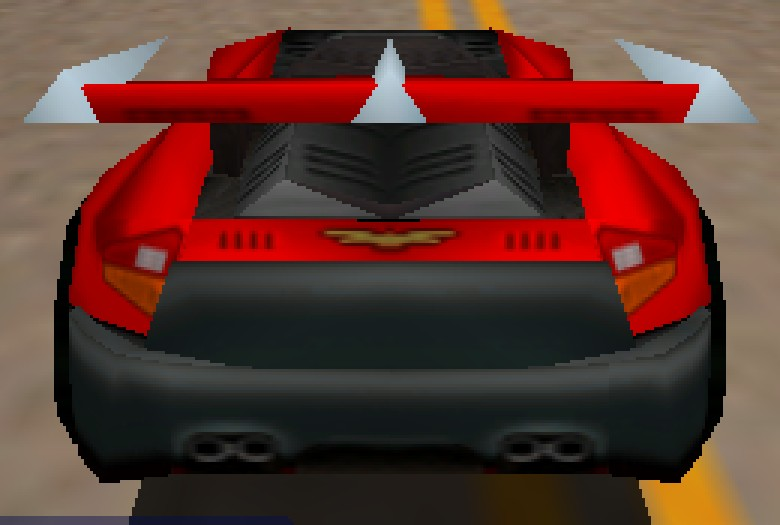
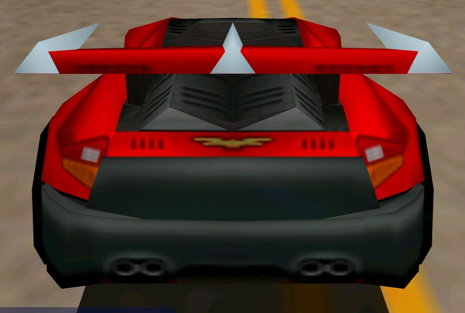
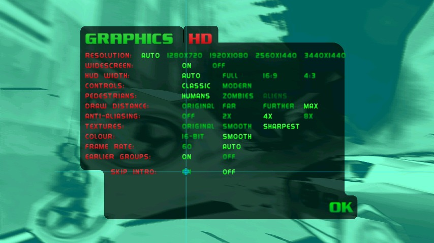

# Carmageddon II HD

An unofficial patch for **Carmageddon II: Carpocalypse Now** (the Steam and GOG.com releases) that makes the 1998 game run well on a modern PC. It brings modern resolutions with ultrawide support, modern controls and controller support, sharper visuals, LAN play restored on today's Windows, and brand-new online play.

It is a binary patch: a small `dinput.dll` that the game loads at start-up and that changes the game in memory. No game file is modified, and no game data is included here: you need your own copy of the game.

It is tested with the Steam and GOG.com releases. Both ship the same game (`CARMA2_HW.EXE` 1.02a, identical byte for byte, as are its renderer drivers); only their CD-music players differ, and the patch plays the music with either.

**[Download the latest release](https://github.com/Deadpoodle/carmageddon-2-hd/releases/latest)** (`carma2hd.zip`), then see [Installing](#installing), or [Steam Deck and Linux](#steam-deck-and-linux) for a one-line install there.

## Contents

- [Before and after](#before-and-after)
- [Features](#features)
- [Installing](#installing)
- [Steam Deck and Linux](#steam-deck-and-linux)
- [Settings](#settings)
- [Controls](#controls)
- [Network play](#network-play)
- [Troubleshooting](#troubleshooting)
- [Not done yet](#not-done-yet)
- [Building](#building)
- [Credits](#credits)

Versions and what changed in each: [CHANGELOG.md](CHANGELOG.md). The main menu shows the version in its bottom right corner.

## Before and after

| Original (Steam release) | Carmageddon II HD |
|---|---|
|  |  |
| The main menu at 640×480 | At your desktop's resolution (here 2560×1440), the backdrop filling the wide screen |
|  |  |
| Races at 640×480 | Races at 2560×1440: a wider view (Hor+), the HUD spread to the edges, 4x anti-aliasing and 16x anisotropic filtering |
|  |  |
| A few seconds in | The same, with the scenery drawn further |
|  |  |
| The player's car, enlarged 3x from 640×480 | The same view at 2560×1440 |



*The patch's settings, on an HD tab beside GRAPHICS (Options → Settings).*

*The "original" shots are the unpatched Steam release (its Glide renderer through nGlide, at the game's 640×480). The others are the patched game full-screen at 2560×1440 with its default settings. Both runs start the same new game; the opponents' cars differ from run to run. The HD tab is from the automated test harness.*

## Features

**Display**
- Your desktop's resolution (or any you choose), rendered by [dgVoodoo2](https://github.com/dege-diosg/dgVoodoo2) through Direct3D 11.
- Widescreen and ultrawide (21:9, 32:9) with a wider view (Hor+), not a stretched one.
- The race HUD spread to the screen's edges (or kept to 16:9, 4:3 or 21:9), with the gaps in the top banner filled.
- Menu and loading pictures stretched to fill a wide screen, with the menus themselves kept at their original shape in the middle. The mouse reaches the whole screen, edge to edge.
- Scenery drawn up to nearly six times as far as the original, and pedestrians, traffic and opponents' detailed models with it, so they no longer pop in just ahead of you.

**Visuals**
- Anti-aliasing (2x, 4x or 8x), 16x anisotropic texture filtering with mipmaps, and full-precision colour instead of 16-bit dithering.
- A frame cap at your screen's refresh rate, never above 100 fps. Above 100 the game's physics run fast.
- Cutscenes enlarged 4x with deband, light sharpening and Lanczos scaling, and shown as large as the screen allows (800x480 of a 16:9 frame instead of 640x384), on true black.
- Sharper text and HUD art: their textures are enlarged 2x with Scale2x.
- The CD music plays: a store compatibility shim had stopped it.
- A music volume bar beside the effects bar, in the Options and pause menus, by mouse, keys or pad, heard at once. The original only had music On or Off.

**Controls**
- A modern keyboard scheme (W/A/S/D or the arrows), and any action can be put on any key.
- Xbox-style controllers through XInput, in races and in menus.
- Every menu works with the arrows, W/S, a controller or the mouse, so the game can be played with a pad alone (a Steam Deck, say). The original left several screens to the mouse:
  - **Change Car:** Left/Right change the car, Up/Down pick OK or CANCEL, Esc (B) cancels.
  - **Load Game:** Up/Down move along the saved games (the list scrolls), Esc (B) cancels.
  - **Wrecks gallery** after a race: Left/Right scroll the wrecked cars, Up/Down pick BUY or OK.
  - **Net game options:** Left/Right on Starting Credit and Target change them.
  - **Lobby:** Esc (B) moves to ABORT GAME, and Esc again aborts.

**Career**
- Finished race groups can be raced again. Arrows either side of **GROUP** on the main menu (or Left/Right with GROUP selected) go back through the groups you have finished, mission included. A race from an earlier group counts as a replay: you stay in the group you have reached, and winning an old mission doesn't skip you ahead. The original only showed these arrows once the whole game was finished.
- The game carries on where you left off: it loads your latest save when it starts (the Graphics screen's **Auto Load**, now on by default). The original started a new game every time unless Auto Load was switched on.

**Zombies**
- A best-effort reconstruction of the censored release based on 28 year old memories, swaps the pedestrians for zombies. Pick **Zombies** under Pedestrians on the HD tab. Needs no extra files.

**Network**
- LAN play restored on modern Windows. The game only speaks IPX, which Windows no longer has; the patch carries it over UDP.
- Online play, new with this patch: the original game is LAN only. Join a game over the internet by typing the host's address on the Network screen. Three or more players work too: the host's copy passes on what the joining players send each other.
- Pedestrians in network races (each player's game has its own). The original game has none online.
- The host's lobby shows the address to give friends, and opens the game's port on the router (UPnP) while hosting.
- Several copies on one PC, for testing.

**Steam Deck and Linux**
- Runs under Proton, with an install script that sets it all up (see [Steam Deck and Linux](#steam-deck-and-linux)). The Deck's 1280x800 screen gets the same wider view and HUD.

**Fixes**
- Pedestrians animate smoothly at high frame rates. The original game's physics undid their animation between its 40 ms ticks, which made them twitch above about 30 fps.
- No crash on the way back to the menus after a long race (the original stopped a "no slot" power-up effect without checking for it).
- Alt+F4, and Close from the taskbar, quit the game. In the original, Alt+F4 left the game hanging, and Close left it running without a window.
- Alt+Tab works. Windows' own compatibility fix for this game blocks it with a keyboard hook, which the patch declines. The game pauses while you're away.
- Moving up or down the pause menu in a race no longer ends the race. In the original, landing on **Abort Race** with the keys (or wrapping round to it from QUIT GAME) aborted the race without a press of Return.
- The time bonus at the end of a race can't go negative. In the original, if the game clock stepped back while the bonus counted up, a 32-bit overflow gave a bonus of minus millions and the race timer started climbing.

**Extras**
- A debug overlay (F2 in a race): frame rate, positions and more, for bug reports.

All of this is on a new **HD** tab of the in-game Graphics screen (Options → Settings), or in `Carma2HD.ini`.

## Installing

The release zip, [`carma2hd.zip`](https://github.com/Deadpoodle/carmageddon-2-hd/releases/latest), holds `dinput.dll`, `dgVoodoo.conf`, the Steam Deck installer and these docs. On Windows:

1. Download `carma2hd.zip` from the [latest release](https://github.com/Deadpoodle/carmageddon-2-hd/releases/latest) and extract it (or build `dinput.dll` yourself, see [Building](#building)).
2. Download [dgVoodoo2](https://github.com/dege-diosg/dgVoodoo2/releases) (tested with 2.87.5). From its `MS\x86` folder, take `DDraw.dll` and `D3DImm.dll`.
3. Put `dinput.dll` and `dgVoodoo.conf` from the zip, and dgVoodoo2's `DDraw.dll` and `D3DImm.dll`, in the game's folder, next to `CARMA2_HW.EXE`.
   - To keep the store's copy untouched, copy the whole game folder somewhere else first and install there.
4. Start the game as usual: Steam's Play button, GOG Galaxy or the GOG shortcut all work. The first start writes `Carma2HD.ini` next to the game, with every setting explained.

To remove the patch, delete those four files and `Carma2HD.ini`.

## Steam Deck and Linux

The patch runs under Proton, Steam's Windows layer, on a Steam Deck or any Linux PC. Proton normally uses its own copies of `dinput.dll` and `ddraw.dll`, so the game needs a launch option that tells it to load the game folder's copies instead:

```
WINEDLLOVERRIDES="dinput,ddraw,d3dimm=n,b" %command%
```

**Installing with the script** (in Desktop Mode): open **Konsole** and paste this line:

```bash
curl -fsSL https://raw.githubusercontent.com/Deadpoodle/carmageddon-2-hd/main/tools/install-steamdeck.sh | bash
```

1. The script:
   - finds the game in any Steam library, on internal storage or an SD card;
   - downloads the [latest release](https://github.com/Deadpoodle/carmageddon-2-hd/releases/latest) and copies in its `dinput.dll` and `dgVoodoo.conf`;
   - downloads dgVoodoo2 2.87.5 from its GitHub releases and checks its `DDraw.dll` and `D3DImm.dll` before copying them in;
   - sets the launch option above, keeping any options already there.
2. Steam rewrites its settings when it exits, so the launch option can only be set while Steam is closed. If Steam is running, the script asks you to exit it (the Steam icon in the taskbar → Exit), then press Enter. Type `s` instead to skip, and paste the line above into **Carmageddon 2 → Properties → General → Launch Options** yourself.
3. Go back to Gaming Mode and start the game as usual.

Running the line again updates the patch to the latest release. To remove the patch, run it with `--uninstall`: it removes the patch files and takes its part out of the launch option.

```bash
curl -fsSL https://raw.githubusercontent.com/Deadpoodle/carmageddon-2-hd/main/tools/install-steamdeck.sh | bash -s -- --uninstall
```

Without internet on the Deck, copy `carma2hd.zip` over, extract it, and run `bash install-steamdeck.sh` from the extracted folder: it then installs that copy instead. dgVoodoo2 still has to be downloaded once.

**The GOG release on Linux** (through Heroic, Lutris or another Wine launcher): the script is for Steam's copy, so install by hand as on Windows, then add `WINEDLLOVERRIDES` with the value `dinput,ddraw,d3dimm=n,b` to the game's environment variables in the launcher.

**On the Deck:**
- **Screen:** `Resolution=auto` picks the Deck's 1280x800. Its 16:10 shape gets a 768x480 Hor+ view, with the HUD spread across the width. Docked, auto picks the external display's resolution instead.
- **Frame rate:** auto follows the screen's refresh rate: 60 on the LCD Deck, 90 on the OLED.
- **Controls:** use Steam Input's **Gamepad** layout. The patch then reads the Deck as an Xbox pad (see [Controls](#controls)), in races and in every menu.
- **Typing** a driver name or an IP address: Steam + X brings up the on-screen keyboard.

**If it doesn't work:**
- **No `Carma2HD.log` in the game folder after a start:** the patch didn't load. Check the launch option.
- **The log says "DirectDraw is ... not dgVoodoo2's":** the launch option is missing `ddraw` or `d3dimm`, so the game is stuck at 640x480.
- **The log's first lines say "running under Wine":** the patch is loaded. It names Proton's Wine version there.

## Settings

Change these on the **HD** tab (Options → Settings → HD) or in `Carma2HD.ini`. The defaults are in brackets.

| Setting | Choices | What it does |
|---|---|---|
| Resolution | **auto**, or e.g. `1920x1080`, `3440x1440` | Auto is your desktop's resolution. |
| Widescreen | **on**, off | On widens the view. Off keeps the original 4:3 picture with bars at the sides. |
| HUD width | **auto**, full, 16:9, 4:3 | How far the HUD spreads on a wide screen. Auto is the screen's width, up to 21:9. |
| Controls | **classic**, modern | See [Controls](#controls). |
| Draw distance | original, far, further, **max** | How far scenery is drawn. Original uses the Graphics tab's own setting. |
| Anti-aliasing | off, 2x, **4x**, 8x | Edge smoothing. |
| Textures | original, smooth, **sharpest** | Smooth is trilinear with mipmaps. Sharpest is 16x anisotropic with mipmaps. |
| Colour | 16-bit, **smooth** | Smooth is full-precision colour. 16-bit is the original dithered look. |
| Frame rate | 60, **auto** | Auto is your screen's refresh rate, capped at 100. |
| Pedestrians | **humans**, zombies | See [Features](#features). |
| Earlier groups | **on**, off | On puts arrows beside the main menu's GROUP, to race finished groups again. Off is the original menu. |

Controls and Earlier groups apply at once. The others can only change as the game starts, so they take effect the next time you start it; the HD tab says so when one of them has changed.

**Auto Load** is the game's own row on the Graphics tab (Options → Settings). It's on by default and kept in `Carma2HD.ini` as `[Game] AutoLoad`.

These are only in `Carma2HD.ini`:
- `[Display]`: `Fullscreen`. `borderless` (the default) is a screen-size window: no display mode change, and Windows can draw over it. `exclusive` gives the screen to the game alone.
- `[Display]`: `Backdrops`. `stretch` (the default) stretches the menu and loading pictures to the full width. `bars` keeps the original 4:3 pictures between black bars.
- `[Visuals]`: `Movies` (enhanced or original), `MovieSize` (fill, the default, or original) and `SharpText` (on or off).
- `[Network]`: see [Network play](#network-play).
- `[Controller]`: `Enabled` (1 or 0).

## Controls

The game keeps four key sets, **A** to **D**, on its Controls screen (Options → Configure Controls, beside CONFIG in the Keys\Buttons panel). The patch adds a fifth, **E**: the modern controls. Choosing E there, or Controls → Modern on the HD tab, switches to it. Choosing A–D, or Classic, switches back. A is the game's default, with driving on the numeric keypad.

**Set E's keys:**

| Action | Key |
|---|---|
| Accelerate / Brake | W / S (the Up / Down arrows too) |
| Steer | A / D (the Left / Right arrows too) |
| Handbrake | Space |
| Use power-up | E |
| Next / previous power-up | Q / Z |
| Power-up list | G |
| Repair (hold) | F |
| Recover | R |
| Wheelspin | X |
| Camera / cockpit | C / V |
| Action replay | P |
| Look up, down, left, right | I, K, J, L |
| Map / mini-map | Tab / M |
| Horn | H |
| Target lock / cycle target | T / Y |
| Sound on/off | F9 (S in sets A–D) |

**Remapping:** on the Controls screen, pick the set, click an action, then press the new key. The game saves each set in its own file (`data\KEYMAP_4.TXT` for E). The game's rules apply: a key already used by another action leaves that action unset, and OK won't close the screen until it has a key again. With set E, the arrow keys keep driving whatever you've moved the driving actions to. Your driving keys also move around the menus; Return selects and Esc goes back.

**Debug overlay:** F2 in a race shows a few lines of numbers above the minimap: frame rate and frame time, race time, the car's position and speed (world units, per second), the camera's position, where the minimap is cutting from the track map, active pedestrians and physics bodies, and the patch version. F2 again hides it; the choice is kept (`[Debug] Overlay`). It's there for tracking down problems: a screenshot with it on says a lot.

**Extra keys** for any action go in `[Keys]` in `Carma2HD.ini`, with any set. For example, `Handbrake=SPACE,LSHIFT`. Key names are DirectInput names: `W`, `UP`, `SPACE`, `LSHIFT`, `LCONTROL`, `RETURN`, `NUMPAD8`, `F1` and so on. The full list of actions is in the ini file.

**Controller** (any XInput pad, e.g. an Xbox controller):

| Race | Button |
|---|---|
| Steer | Left stick |
| Accelerate / Brake | Right trigger / Left trigger |
| Handbrake | A |
| Recover | B |
| Use power-up | X |
| Camera | Y |
| Previous / next power-up | LB / RB |
| Map | Back |
| Horn / Repair | Left stick click / Right stick click |
| Pause menu | Start |

In menus, the D-pad or left stick moves, A or Start selects, and B or Back goes back.

## Network play

The game's network mode lets up to 12 players race each other on a LAN. The patch restores that on modern Windows and adds play over the internet, which the original never had:
- **On a local network (LAN)**, games are found automatically.
- **Over the internet**, you type the host's address.

Everyone, host or not: the first time you open the Network screen, Windows asks whether the game may use the network. Allow it, on private networks at least.

### Hosting

1. Choose **Network game** on the main menu.
2. Pick a game type and track on the left, then press **HOST**.
3. The lobby opens. Wait for the other players' names to appear, then press **START**.

While you host, three lines above **ABORT GAME** in the lobby show what friends over the internet need:

| Line | Meaning |
|---|---|
| YOUR ADDRESS: 203.0.113.5 | Your public address: give it to the joining players. A port follows it if you changed `[Network] Port`. *FINDING YOUR ADDRESS...* shows for the few seconds the lookup takes; *NOT FOUND* means neither your router nor the web service answered. |
| PORT 47700 OPENED ON YOUR ROUTER | The game asked your router to open its port (UPnP) and the router agreed. Nothing else to do. The port is closed again when you stop hosting or quit. |
| FORWARD UDP PORT 47700 ON ROUTER | Your router doesn't do UPnP, has it turned off, or refused. Forward the port by hand: your router's manual or admin page calls this "port forwarding". Point it at the address on the next line. |
| DOUBLE NAT: FRIENDS MAY NOT CONNECT | Your router's own internet address is a private one: there's another router or your provider's network in front of it. Friends probably can't reach you, even with the port forwarded; one of them may have better luck hosting. |
| ON YOUR LAN: 192.168.1.20 | This PC's address on your home network. Players on the same network don't need it: they see your game in the list. |

The address comes from your router first (UPnP), and from a web service (api.ipify.org) if the router doesn't say. All of this can be turned off; see the settings below.

### Joining over a LAN

1. Choose **Network game**.
2. The host's game appears in the **Join a game** list within a few seconds. Click it, then press **JOIN**.

### Joining over the internet

1. Choose **Network game**.
2. Click the **IP:** box at the bottom of the **Join a game** panel. A blinking cursor appears, with *TYPE, THEN PRESS RETURN* under the box.
3. Type the host's address and press **Return**:
   - an IP address, e.g. `203.0.113.5`;
   - with a port if the host changed it, e.g. `203.0.113.5:47800`;
   - or a host name.
4. The line under the box shows what happens next:

   | Message | Meaning |
   |---|---|
   | NOT A VALID ADDRESS | It isn't an IP address (four numbers from 0 to 255 with dots between them), a name, or a port from 1 to 65535. Nothing is sent. |
   | LOOKING UP THE ADDRESS... | You typed a name; it's being looked up. |
   | ADDRESS NOT FOUND | The name couldn't be looked up. Check it. |
   | SEARCHING... 15 | Asking that address for a game, every 3 seconds. The number counts down the 15 seconds the search is shown for. |
   | FOUND: PRESS JOIN | The host answered. Its game is selected in the list with its details shown, and **JOIN** is ready: press Return or click JOIN. |
   | NO GAME FOUND THERE | Nothing answered in 15 seconds. See below. It keeps listening while you stay on this screen, so a game that's hosted later still shows up; to count down again, click the box and press Return. |
   | THAT GAME CANNOT BE JOINED | The host answered, but its game has already started or is full. |

**JOIN stays greyed out until the game list has a game in it.** That's the original game's rule. If it stays grey:
- check the host is on the Network screen and has pressed HOST;
- check the host's lobby says the port is open, or that the host has forwarded UDP port 47700;
- check the address is right.

Press **Esc** while typing to cancel. Press **Return** on an empty box to clear the address. Games on your LAN still show up while an address is set. The address is saved, as `[Network] JoinAddress`.

### Notes

- **Three or more players over the internet** work through the host. In a race every player also talks to every other player directly, and over the internet the joining players usually can't reach each other, only the host. So the host's copy passes their messages on, and only the host needs to forward a port. It's a small part of the traffic (most of it goes between each player and the host anyway), so the host's connection hardly notices. Players on the same LAN still talk directly.
- **Players must all use this patch.** The Steam release's own network layer (ipxwrapper) can't talk to it. `[Network] Transport=ipxwrapper` puts the original back, for LAN games with unpatched copies.

### Network settings

| Setting | Default | Meaning |
|---|---|---|
| `Port` | 47700 | UDP port. The first copy on a PC uses it, and further copies the next ones, up to Port+7. |
| `JoinAddress` | (empty) | The address the IP box sets. |
| `Pedestrians` | 1 | 1 = pedestrians in network races. Each player's game runs its own, so players see different crowds; kills earn your own credits only. 0 = none, as the original. |
| `Transport` | udp | `udp` is the patch; `ipxwrapper` is the store's original, LAN only. |
| `UPnP` | 1 | 1 = ask the router for the public address (and to open the port) while hosting; 0 = don't talk to the router. |
| `OpenPort` | 1 | 1 = ask the router to open the port while hosting; 0 = only ask for the address. |
| `PublicIPService` | https://api.ipify.org | The web service asked for the public address when the router doesn't say. It must answer with the address as plain text. Empty = never ask one. |

## Troubleshooting

- **What the patch did:** `Carma2HD.log` next to the game records each start-up: the settings it read, the patches it applied, and anything that failed.
- **If the game freezes or crashes:** the log records where. Please include it in any report.
- **To reset a setting:** delete `Carma2HD.ini`. The next start writes the defaults again.
- **The picture is in a corner, or the mouse stops partway across the screen:** make sure `dgVoodoo.conf` is in the game folder. The patch keeps its settings in step, but only if the file is there.

## Not done yet

- **Alien pedestrians**, the German release's mode. It needs the original disc data to look right, so the option is greyed out.

## Building

You need a 32-bit MinGW-w64 GCC. On Windows, use MSYS2's `mingw32` environment: `pacman -S mingw-w64-i686-gcc`. Then:

```bash
./build.sh
```

This writes `build/dinput.dll`. On Linux, run `CXX=i686-w64-mingw32-g++ ./build.sh`.

- **Source:** `src/`. Each module's opening comment says what it changes and why.
- **Reverse-engineering notes:** `re/`, with the addresses and how each part of the game works.
- **Test harness:** the `C2HD_*` environment variables in `src/main.cpp` run the game hidden and scripted (hover sweeps, key sweeps, a scripted pad), so changes are tested without using the screen. `tools/screendrive.py` runs real full-screen checks.

## Credits

- [dgVoodoo2](https://github.com/dege-diosg/dgVoodoo2) by Dege: the Direct3D wrapper that renders the game.
- [PCGamingWiki](https://www.pcgamingwiki.com/wiki/Carmageddon_II:_Carpocalypse_Now): its collected fixes and notes.
- Carmageddon II is © Stainless Games and SCi. This project is not affiliated with them.

Released into the public domain (see [LICENSE](LICENSE)).
